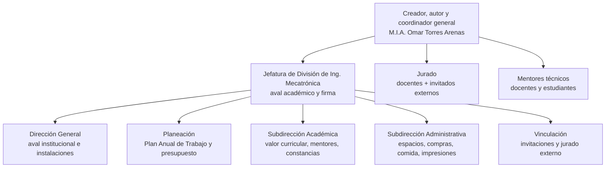

# MecaChallenge 2026

**El primer concurso de tecnología para preparatorianos de la región.**
*Resuelve. Construye. Innova.*

Edición I · Instituto Tecnológico Superior de Jerez (ITSJ) · TecNM · Jerez de García Salinas, Zacatecas, México

**Creador y autor:** M.I.A. Omar Torres Arenas, docente de la División de Ingeniería Mecatrónica del ITSJ.

---

## ¿Qué es MecaChallenge?

MecaChallenge es un concurso presencial de un solo día en el que equipos de estudiantes de preparatoria resuelven un problema real con ingeniería real: diseñan, arman y programan un sistema con Arduino a partir de un kit cerrado de componentes.

Lo que lo distingue es que **la inteligencia artificial generativa es parte del reto**. Los equipos deben usarla para aprender y resolver obstáculos, y documentar cada uso en un **Diario de IA**, que vale el 20 % de la calificación. En la presentación final ante el jurado, en cambio, no se permite usar IA: tienen que defender su trabajo con sus propias palabras.

Este repositorio publica los materiales de la primera edición para que otros docentes e instituciones puedan usarlos como referencia y organizar un concurso similar.

## Resumen del evento

| | |
|---|---|
| Público | Estudiantes de preparatoria de la región |
| Formato | Presencial, por equipos, un solo día (8:20–14:30 h) |
| Equipos | 4 a 5 |
| Reto | Sistema de monitoreo y control automatizado para un invernadero |
| Plataforma | Arduino UNO R3 con kit cerrado (sin componentes externos) |
| Presentación | 3 min por equipo, demostración en vivo y defensa oral sin IA |
| Premios | 1.º, 2.º y 3.er lugar (jurado) + Premio del Público (votación en Google Form) |

### El reto de la Edición I

Don Ernesto, un productor de tomate de Guadalupe, Zacatecas, perdió más de la mitad de su cosecha cuando su invernadero llegó a 47 °C mientras él no estaba. Los equipos deben construir un sistema que:

1. Monitoree temperatura, humedad del aire y humedad del suelo en tiempo real.
2. Muestre el estado con un semáforo LED (verde, amarillo, rojo).
3. Active un buzzer ante condiciones críticas.
4. Mueva un servo que simula la ventilación o la válvula de riego.
5. Se presente y demuestre en vivo en 3 minutos.

**Kit por equipo:** Arduino UNO R3, DHT11, sensor de humedad de suelo, servo SG90, LEDs rojo/amarillo/verde, buzzer, 10 resistencias de 220 Ω, protoboard, cables Dupont y cable USB-B.

### Evaluación

| Criterio | Peso |
|---|---|
| Funcionalidad del sistema | 30 % |
| Calidad del código | 20 % |
| Integración con IA (Diario de IA) | 20 % |
| Presentación oral | 20 % |
| Creatividad e innovación | 10 % |

**Mínimo funcional para ser evaluado:** leer el DHT11 y el sensor de suelo, encender el LED del estado actual y activar el buzzer o el servo ante una condición crítica.

### Programa del día

| Hora | Actividad |
|---|---|
| 8:20 | Registro y entrega de kits |
| 8:40 | Apertura oficial |
| 9:00 | Taller de IA aplicada al desarrollo (30 min) |
| 9:30 | Desarrollo — Bloque 1 |
| 11:00 | Revisión de avance con mentores |
| 11:15 | Desarrollo — Bloque 2 |
| 12:45 | Cierre de código |
| 13:00 | Presentaciones ante el jurado |
| 13:45 | Deliberación del jurado y votación del público |
| 14:00 | Premiación y clausura |
| ≤ 14:30 | Devolución de kits y cierre |

## Modelo de organización

El evento fue concebido y diseñado por una sola persona, su creador, que delega partes del trabajo en las áreas del Instituto. Así cada área aporta lo que le corresponde sin cargar con todo el evento:



| Quién | Qué hace |
|---|---|
| **Creador y coordinador general** | Concibe el evento, diseña todos los materiales (convocatoria, reglamento, problemática, kit, Diario de IA, rúbrica), imparte el taller de IA, coordina a los mentores, resguarda la problemática y entrega el informe post-evento. |
| **Jefatura de División** | Avala y firma los documentos oficiales y hace de enlace con las autoridades y las demás áreas. |
| **Dirección General, Planeación, Subdirección Académica** | Aval institucional, presupuesto, valor curricular y constancias. |
| **Subdirección Administrativa, Vinculación** | Logística, compras, alimentos, impresiones e invitaciones a preparatorias y al jurado externo. |

El detalle está en [docs/03-responsabilidades.md](docs/03-responsabilidades.md).

## Contenido del repositorio

| Documento | Markdown | PDF |
|---|---|---|
| Problemática del reto, kit, criterios y restricciones | [01-problematica.md](docs/01-problematica.md) | [PDF](pdf/01-problematica.pdf) |
| Itinerario oficial | [02-itinerario.md](docs/02-itinerario.md) | [PDF](pdf/02-itinerario.pdf) |
| Responsabilidades y delegación por área | [03-responsabilidades.md](docs/03-responsabilidades.md) | [PDF](pdf/03-responsabilidades.pdf) |
| Guion del maestro de ceremonias | [04-guion-maestro-de-ceremonias.md](docs/04-guion-maestro-de-ceremonias.md) | [PDF](pdf/04-guion-maestro-de-ceremonias.pdf) |

Los nombres de autoridades y jurados se reemplazaron por espacios **[entre corchetes]** para que el guion sirva de plantilla.

### Regenerar los PDF

Los PDF se generan a partir de los Markdown con [pandoc](https://pandoc.org/) y XeLaTeX:

```bash
./build.sh
```

## Cómo replicarlo en tu institución

1. **Define el problema** con un caso local y concreto (en esta edición, un invernadero de Zacatecas) y un kit cerrado y barato que lo resuelva.
2. **Prepara los materiales:** convocatoria, problemática, rúbrica, Diario de IA, itinerario y guion. Puedes partir de los de este repositorio.
3. **Reparte el trabajo:** busca el aval de tu jefatura o dirección y delega logística, compras, invitaciones y constancias en las áreas que ya hacen ese trabajo.
4. **Arma el equipo del día:** mentores técnicos (docentes y estudiantes) y un jurado mixto de academia e industria.
5. **Resguarda la problemática** hasta el inicio del reto para que todos los equipos compitan en igualdad.
6. **Cierra con un informe:** resultados, lecciones aprendidas y propuesta para la siguiente edición.

## Hacia la Edición 2

A partir de la siguiente edición se busca que empresas regionales de Jerez, Zacatecas y Aguascalientes propongan problemáticas reales y apadrinen kits, premios o becas. Los proyectos premiados podrán servir como semilla para residencias profesionales y estadías dentro del MEDTecNM.

## Autoría y licencia

MecaChallenge es una idea original del **M.I.A. Omar Torres Arenas**, quien creó el concurso y escribió todos sus materiales.

Los materiales se comparten bajo la licencia [Creative Commons Atribución 4.0 Internacional (CC BY 4.0)](LICENSE). Puedes usarlos, adaptarlos y redistribuirlos, incluso con fines comerciales, siempre que des crédito al autor y enlaces a este repositorio.
